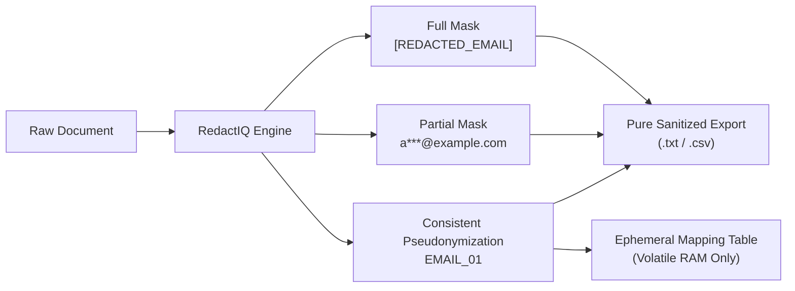

# RedactIQ 🛡️

> **Redact PII. Nothing leaves your browser.**  
> A zero-trust, high-performance client-side PII detection, classification, and sanitization engine built with React and Vite.

[](vercel.json)
[](Dockerfile)
[](src/lib/__tests__)
[](src/lib)
[](LICENSE)

---

## 1. Problem Statement

Modern workflows routinely require sharing server logs, customer support tickets, resume databases, clinical intake notes, and CSV data extracts with third parties, LLMs, and external contractors. Unfortunately, these datasets frequently contain sensitive Personally Identifiable Information (PII) such as payment card numbers, national identification numbers, phone numbers, and IP addresses.

Most commercial scrubbing tools rely on cloud backends or external AI APIs. Sending sensitive data to an external server introduces severe compliance and security risks (GDPR, HIPAA, PCI-DSS, India DPDP Act), potential data retention liabilities, and man-in-the-middle exposure.

**RedactIQ solves this by executing 100% of detection, mathematical validation, and redaction inside the user's browser memory.**

---

## 2. Core Features

- **100% Client-Side In-Memory Execution**: Zero backend, zero telemetry, zero analytics, zero external API calls. Enforced at runtime via strict Content Security Policy (`connect-src 'none'`).
- **Mathematical Algorithmic Validation**:
  - **Verhoeff Checksum**: Validates 12-digit Indian Aadhaar numbers using the dihedral $D_5$ group algorithm. Failed 12-digit numbers are tracked as Verhoeff failures.
  - **Luhn Algorithm**: Modulo-10 checksum validation on 13–19 digit credit cards. Prevents false-positive flags on random numerical sequences.
  - **Checksum-Failed Notification**: Detailed summary reporting: `"Checksum-failed numbers ignored: N cards (Luhn), M Aadhaar-like (Verhoeff)"`.
  - **Strict Checksum Validation Toggle**: On by default for maximum precision. When toggled off, numbers matching card or Aadhaar formatting that fail algorithmic checksums are also detected and redacted, explicitly flagged with an `(unverified)` label for maximum caution.
  - **Octet-Bounded IP Validation**: Strict $0–255$ boundary checks rejecting invalid IPs (e.g., `999.1.1.1`).
- **Four Flexible Redaction Modes**:
  1. **Full Mask**: High-security token substitution (`[REDACTED_EMAIL]`, `[REDACTED_CARD]`).
  2. **Partial Mask**: Retains diagnostic context while protecting identity (`j***@gmail.com`, `XXXXXX3210`, `XXXX-XXXX-XXXX-1234`).
  3. **Consistent Pseudonymization**: Maps identical normalized entities to deterministic placeholders (`EMAIL_01`, `PHONE_01`) across the document. Guaranteed comma-free to preserve CSV structure.
  4. **Custom Mode**: Granular per-entity type strategy configuration (e.g. Email = Partial, Aadhaar = Partial, others = Full Mask).
- **Interactive Per-Item Overrides**: Click or activate any detected entity span in the Original panel to open an accessible popover and override its redaction behavior (`Full Mask`, `Partial Mask`, `Pseudonym`, or `Don't redact`). Overrides apply to the entity's normalized value so all occurrences stay synchronized, with an `• edited` indicator and a 1-click `Reset all overrides` action.
- **Privacy Risk Exposure Meter & Cautious Guidance**: Real-time 0–100 sensitivity scoring (`Low`, `Medium`, `High`, `Critical`) using mathematical sensitivity weights (Payment Cards & Aadhaar high, PAN & Phone medium, Email medium-low, IP low). Strictly adheres to privacy-first guidance wording (never says "Safe to transmit", advises review when no PII is detected, and flags unverified candidate IDs).
- **Regulatory Compliance Framework Flags**: Automatic live detection of applicable regulatory domains: **PCI-DSS v4.0** (Cardholder data), **India DPDP Act 2023** (Digital personal identification), and **EU GDPR Art. 4** (Personal contact & IP telemetry).
- **User-Defined Custom Detection Rules**: Add custom proprietary terms, codenames, or regular expressions directly from the UI. Detected as custom entity chips with full redaction mode support and resilient regex error boundaries that never crash.
- **Zero-PII JSON Compliance Audit Report**: 1-click export of structured security reports containing environment assertions, timestamps, exact entity counts, risk scores, Luhn/Verhoeff failure tallies, and regulatory flags with a mathematical guarantee of zero unmasked PII.
- **Side-by-Side Audit View**: Real-time comparison between original source text and sanitized output with color-coded entity tags. Implemented using React element tokens with **zero `dangerouslySetInnerHTML`** to prevent XSS.
- **Ephemeral Pseudonymization Mapping Table**: Reverse-lookup table visible only in pseudonymization mode. Stored strictly in volatile RAM and automatically excluded from exports.
- **Safe 1-Click Export**:
  - **Download Sanitized File**: Downloads clean output preserving original file format (`.txt` or `.csv`) and naming (`sanitized_<originalname>`). Contains pure redacted text without UI badges or label text.
  - **Copy to Clipboard**: Instant copy of pure sanitized text with visual confirmation.
  - **Download Audit Report (JSON)**: Secondary 3D button matching the export toolbar style.
- **Tactile Vercel/Stripe-Tier UI**:
  - Dual themes: Clean Light (`#F5F9FC`, default on first visit) and Deep Navy (`#050B18`), with persistent user preference in `localStorage`.
  - Interactive 3D card perspective tilt with dynamic specular glare.
  - Custom fluid trailing cursor with fine-pointer detection.
  - Tactile 3D buttons with mouse-follow radial glow.
- **High Performance**: 200 ms input debounce with `useMemo` computation caches. Comfortably processes large files (up to 5 MB) without main-thread UI stutter.

---

## 3. Supported Entity Types & Detection Mechanics

| Entity Type | Pattern & Boundaries | Mathematical Validation | Normalization |
| :--- | :--- | :--- | :--- |
| **EMAIL** | Standard RFC-compliant email regex (`\b[A-Za-z0-9._%+-]+@[A-Za-z0-9.-]+\.[A-Za-z]{2,}\b`) | Domain and TLD boundary validation | Lowercase string |
| **PHONE** | Indian mobile (10 digits starting 6–9, optional `+91` or `0` prefix) & International E.164 | Digit length and starting prefix rules | 10-digit number (e.g., `9876543210`) |
| **IP** | IPv4 (`0–255` per octet) and standard IPv6 addresses | Strict octet integer boundary checks; leading zeros and out-of-bounds numbers rejected | Normalized IP string |
| **PAN** | Indian Permanent Account Number (`[A-Z]{5}[0-9]{4}[A-Z]`) | 4th character validated against allowed taxpayer statuses (`P`, `C`, `H`, `F`, `A`, `T`, `B`, `L`, `J`, `G`) | Uppercase string |
| **AADHAAR** | 12 digits, first digit 2–9, optional `4-4-4` grouping with spaces/dashes | **Verhoeff Checksum** (Dihedral $D_5$ group multiplication & permutation tables) | 12 digits |
| **CREDIT_CARD** | 13–19 digits, optional space/dash delimiters | **Luhn Algorithm** (Modulo 10 check). Failed numbers are safely skipped and reported in the summary bar | Clean numeric digits |
| **CUSTOM_RULE** | User-defined keywords (case-insensitive) or arbitrary Regex patterns | Boundary checks and safe regex compilation | Lowercase string |

### Overlap Resolution Strategy
When text matches multiple patterns (e.g., a credit card containing a substring that matches phone or Aadhaar rules), RedactIQ uses a strict precedence hierarchy:
$$\text{Credit Card} > \text{Aadhaar} > \text{PAN} > \text{IP} > \text{Email} > \text{Phone}$$
Longer, mathematically verified matches always take precedence over shorter or unvalidated regex matches.

---

## 4. Redaction Modes



1. **Full Mask**: Replaces every detected match with `[REDACTED_<TYPE>]` (e.g. `[REDACTED_EMAIL]`, `[REDACTED_CREDIT_CARD]`). Ideal for strict compliance workflows.
2. **Partial Mask**: Obfuscates sensitive characters while preserving diagnostic clues:
   - Email: `alice@example.com` $\rightarrow$ `a***@example.com`
   - Phone: `+91 98765 43210` $\rightarrow$ `XXXXXX3210`
   - Credit Card: `4111 1111 1111 1111` $\rightarrow$ `XXXX-XXXX-XXXX-1111`
   - Aadhaar: `2345 6789 1234` $\rightarrow$ `XXXX-XXXX-1234`
   - PAN: `ABCDE1234F` $\rightarrow$ `XXXXX1234X`
   - IP: `192.168.1.100` $\rightarrow$ `192.168.XXX.XXX`
3. **Consistent Pseudonymization**: Maps identical normalized entities to the exact same placeholder throughout the text (`EMAIL_01`, `EMAIL_02`, `PHONE_01`). Even if a phone number appears once as `+91 98765 43210` and later as `9876543210`, both resolve to `PHONE_01`. Replacements never contain commas, ensuring CSV integrity.
4. **Custom Redaction Strategy**: Provides granular per-entity type strategy selection. Configure emails and Aadhaar IDs to use partial masking for operational context, while payment cards, phone numbers, IPs, and PAN numbers remain fully redacted.
5. **Per-Item Overrides & Exclusions**: Directly click any highlighted entity in the Original panel to open an accessible popover and customize its masking (`Use default`, `Full Mask`, `Partial Mask`, `Pseudonym`, `Don't redact`). Overrides are mapped to normalized values, synchronizing across every document occurrence in memory. Items marked as "Don't redact" are excluded from transformation and reported in the summary counter.

---

## 5. Zero-Trust Privacy & Security Architecture

RedactIQ is built on the principle that the most secure data transfer is **no data transfer at all**.

- **No Network Egress**: Strict CSP header applied in production:
  ```http
  Content-Security-Policy: default-src 'self'; connect-src 'none'; style-src 'self' 'unsafe-inline'; script-src 'self'; img-src 'self' data:;
  ```
  `connect-src 'none'` guarantees that even if a malicious script were injected, the browser blocks any `fetch`, `XMLHttpRequest`, `WebSocket`, or `EventSource` connection.
- **Volatile Memory Model**: Text, file uploads, detection matches, and pseudonymization mapping tables are held strictly in React component state. Nothing is written to `localStorage`, `sessionStorage`, `IndexedDB`, or cookies.
- **Zero XSS via Safe DOM Construction**: Highlighting is rendered using React elements (`<span>`) mapping character offsets. We **never** use `dangerouslySetInnerHTML`.
- **System Fonts Only**: No external font requests to Google Fonts or Typekit that could leak IP addresses or metadata.

---

## 6. Accessibility & Inclusivity

- **WCAG 2.1 AA/AAA Contrast**: All text and highlight badges maintain a contrast ratio $\ge 4.5:1$ (and up to $11:1$ on text) in both Dark and Light themes.
- **Multi-Modal Signaling**: Information is never conveyed by color alone. Every highlight chip includes an explicit text badge (e.g. `[EMAIL]`, `[IP]`).
- **Screen Reader Support**: Live updates use `aria-live="polite"` regions to announce detection counts without interrupting screen reader speech.
- **Keyboard Navigation**: Full tab index hierarchy with high-contrast visible focus rings (`:focus-visible`).
- **Motion Reduction**: Full `@media (prefers-reduced-motion: reduce)` support. When enabled, 3D card tilts, cursor trailing rings, entrance transitions, and button glows are disabled.

---

## 7. Tech Stack

- **Framework**: React 18
- **Build Tool**: Vite 6
- **Styling**: Plain CSS with CSS Custom Properties (zero CSS framework dependencies)
- **Unit Testing**: Vitest (64 automated tests covering math, regex, overlap resolution, strict/unverified modes, risk scoring, compliance flags, and export sanitation)
- **Linting**: ESLint with `react/recommended` and `react-hooks` rules

---

## 8. Getting Started

### Prerequisites
- Node.js `20.x` or higher
- npm `10.x` or higher

### Local Development
```bash
# Clone the repository
git clone https://github.com/ruthviksriram/redactiq.git
cd redactiq

# Install dependencies
npm ci

# Start local development server (live HMR)
npm run dev
```
Open [http://localhost:5173](http://localhost:5173) in your browser.

### Running Tests, Linting, and Coverage
```bash
# Run all Vitest unit, edge-case, and component tests
npm test

# Run all tests with V8 coverage analysis (threshold >= 90% on src/lib)
npm run test:coverage

# Run ESLint validation (including jsx-a11y)
npm run lint

# Test production build bundle with CSP injection
npm run build
```

---

## 9. Testing & Code Quality

RedactIQ is verified by 76 automated tests spanning unit regex/checksum logic, edge cases (empty strings, zero PII, Unicode text, 100k-character stress payloads, path traversal sanitization), and full component integration flows via React Testing Library.

### V8 Code Coverage (`src/lib`)

| File | % Stmts | % Branch | % Funcs | % Lines | Uncovered Lines |
| :--- | :--- | :--- | :--- | :--- | :--- |
| **All files (`src/lib`)** | **98.56%** | **84.05%** | **100%** | **98.56%** | |
| `constants.js` | 100% | 100% | 100% | 100% | |
| `detectors.js` | 99.69% | 86.3% | 100% | 99.69% | 277 |
| `redact.js` | 95.52% | 76.78% | 100% | 95.52% | 102-104 |
| `risk.js` | 97.33% | 85.96% | 100% | 97.33% | 51, 146 |
| `sampleData.js` | 100% | 100% | 100% | 100% | |
| `validators.js` | 100% | 86.95% | 100% | 100% | |

### Accessibility & Hardening
- **WCAG 2.1 AA Compliance**: Enforced via `eslint-plugin-jsx-a11y` with 0 warnings or errors across the entire codebase. Interactive text markers in the audit view are rendered as accessible native `<button>` elements with ARIA dialog/menu attributes.
- **Client-Side Sandbox Integrity**: Wrapped with a zero-telemetry React `ErrorBoundary` and verified by Content Security Policy (`connect-src 'none'`).
- **Filename Traversal Defense**: All uploaded and exported files are processed through `sanitizeFileName()`, stripping null bytes, directory separators (`../`), and ASCII control characters.

---

## 10. Deployment

### Option A: Vercel (Primary & Recommended)
RedactIQ includes a preconfigured `vercel.json` with build settings, SPA route fallbacks, and hardened production headers:

```bash
# Deploy with Vercel CLI
npx vercel --prod
```
Or connect your GitHub repository directly to [Vercel](https://vercel.com). Vercel automatically detects the Vite framework and applies the settings in `vercel.json`.

### Option B: Google Cloud Run (Alternative)
A multi-stage container configuration (`Dockerfile` + `nginx.conf`) is included:

```bash
# 1. Build and submit image via Google Cloud Build
gcloud builds submit --tag gcr.io/YOUR_PROJECT_ID/redactiq

# 2. Deploy to Cloud Run (serves on port 8080)
gcloud run deploy redactiq \
  --image gcr.io/YOUR_PROJECT_ID/redactiq \
  --platform managed \
  --region us-central1 \
  --allow-unauthenticated \
  --port 8080
```

---

## 11. Known Limitations

- **Personal Names (Named-Entity Recognition)**: Personal names (e.g. "John Smith", "Priya Sharma") are intentionally **not** detected. Accurate detection of arbitrary person names requires statistical Natural Language Processing (NLP) or machine learning models (such as BERT or LLMs). Bundling large ML models into the browser would degrade load times and memory efficiency, while calling external cloud NER APIs would violate RedactIQ's core zero-trust, client-side privacy guarantee.
- **Unstructured Physical Addresses**: Non-standardized street addresses without postal codes are omitted for similar reasons. Structured entities (IPs, emails, phone numbers, tax IDs, and payment cards) are detected with mathematical precision.
- **Encrypted or Scanned PDF Files**: RedactIQ processes plain text, log files, and CSV files (`.txt`, `.csv`). Scanned images or OCR-dependent PDFs must be converted to plain text prior to redaction.

---

## 12. License

MIT License. Designed and built with privacy, precision, and performance.
